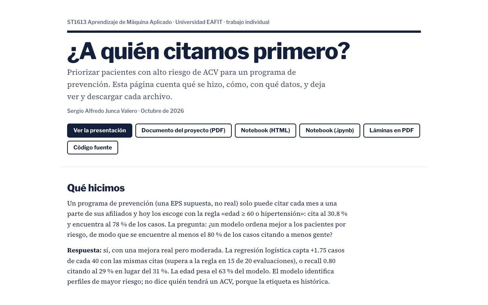
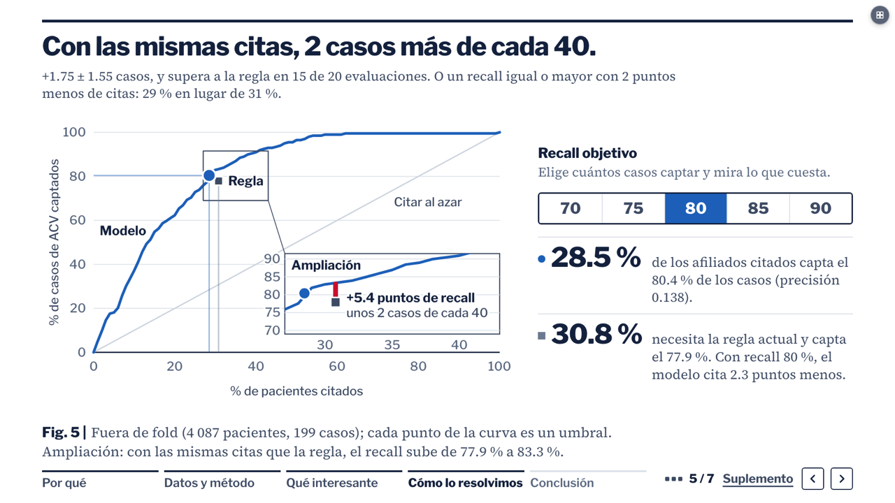
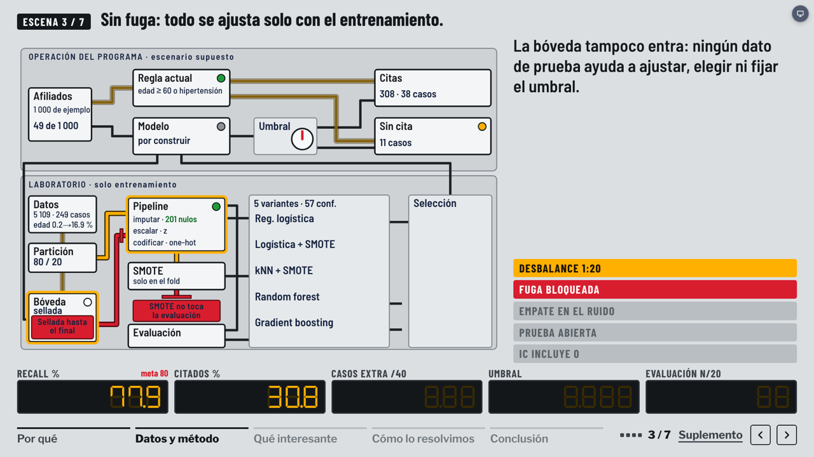
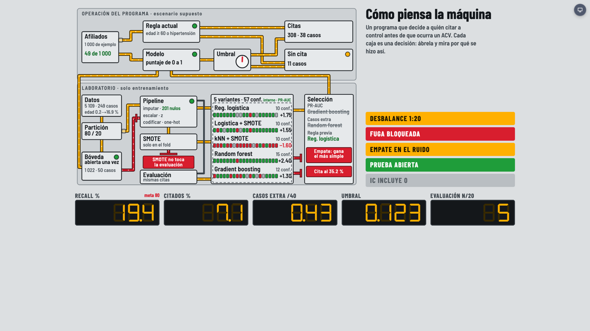
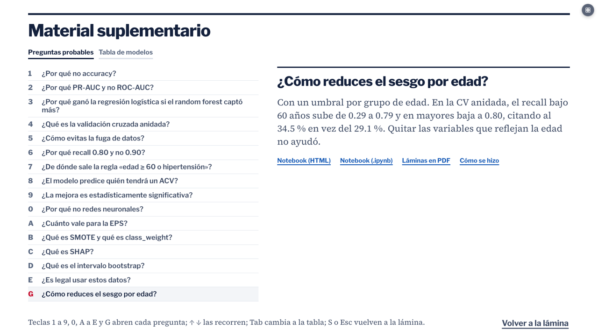

# ¿A quién citamos primero?

Proyecto final de **ST1613 Aprendizaje de Máquina Aplicado** (Universidad EAFIT, 2026). Autor: Sergio Alfredo Junca Valero, trabajo individual.

Un programa de prevención solo puede citar cada mes a una parte de sus afiliados. ¿Puede un modelo escoger mejor a quién citar que la regla «edad ≥ 60 o hipertensión», y encontrar al menos el 80 % de los casos de accidente cerebrovascular (ACV) citando a menos gente?

**Entrada principal: https://sjunka.github.io/acv-prevencion-ml/about/**. Ahí está qué se hizo y cómo, los datos, las láminas, el documento del proyecto en PDF, el notebook para ver y descargar, y el enlace a la presentación.

[](https://sjunka.github.io/acv-prevencion-ml/about/)

## Resultado

- **Gana la regresión logística.** Con las mismas citas que la regla capta +1.75 casos de cada 40 (supera a la regla en 15 de 20 evaluaciones de la validación cruzada anidada). Dicho de otra forma: recall 0.80 citando al 29 % de los pacientes en lugar del 31 %.
- **Prueba sellada** (50 casos, abierta una vez): recall 0.80 y +1 caso frente a la regla, con IC 95 % de 0 a 4. La mejora es real pero moderada, y la prueba sola no la demuestra.
- **Sesgo por edad.** Con un solo umbral, el modelo capta 0.29 de los casos menores de 60 años. Un umbral por grupo de edad lo sube a 0.79 (los de 60 o más bajan de 0.99 a 0.80), a cambio de citar al 34.5 % en lugar del 29.1 %. En la prueba: 5 de 12 casos jóvenes en lugar de 2. Quitar las variables que reflejan la edad no ayudó. Queda como opción de operación.
- **Límites.** La etiqueta `stroke` dice quién ya tuvo un ACV, no quién lo tendrá. La edad pesa el 63 % del modelo. La EPS y su regla son un supuesto del ejercicio.

## Qué hay en el sitio

| Dirección | Qué es |
|---|---|
| [`/about/`](https://sjunka.github.io/acv-prevencion-ml/about/) | Qué se hizo y cómo, sesgo por edad, datos, láminas en miniatura, documento, notebook y descargas |
| [`proyecto-final.pdf`](https://sjunka.github.io/acv-prevencion-ml/proyecto-final.pdf) | Documento del proyecto final (6 páginas) |
| [`/`](https://sjunka.github.io/acv-prevencion-ml/) | La presentación: 7 láminas, 23 clics, unos 10 minutos |
| [`?vista=tablero`](https://sjunka.github.io/acv-prevencion-ml/?vista=tablero) | El mismo recorrido como un tablero de dos carriles (tecla `L`) |
| [`?vista=maquina`](https://sjunka.github.io/acv-prevencion-ml/?vista=maquina) | Máquina explicada: el porqué de cada decisión (tecla `K`) |
| [`proyecto.html`](https://sjunka.github.io/acv-prevencion-ml/proyecto.html) · [`proyecto.ipynb`](https://sjunka.github.io/acv-prevencion-ml/proyecto.ipynb) | El notebook ejecutado de cero |
| [`sustentacion.pdf`](https://sjunka.github.io/acv-prevencion-ml/sustentacion.pdf) | Respaldo en PDF: portada y una lámina por página |

| Lámina | Tablero (`L`) |
|---|---|
|  |  |
| **Máquina explicada (`K`)** | **Preguntas probables (`S`)** |
|  |  |

## Teclas de la presentación

| Tecla | Acción |
|---|---|
| `→` `←` | Paso siguiente y anterior (también el control remoto). Al retroceder, el paso se ve ya armado |
| `S` | Preguntas probables y tabla de modelos; `1` a `9`, `0`, `A` a `E` y `G` abren cada pregunta |
| `L` | Cambia entre láminas y tablero, en el mismo clic |
| `K` | Máquina explicada; al volver, la lámina sale en su primer clic |
| `N` | Guion de la lámina |
| `T` / `R` | Reloj de 10 minutos / reiniciarlo |
| `F` | Pantalla completa |
| `?` | Ayuda |

Cada paso tiene su enlace: `#3.2` abre la lámina 3 en su segundo clic. Con `?movimiento=reducido` (o con esa preferencia del sistema) no hay desplazamientos. Imprimir la página da un PDF de una lámina por página.

## Método en breve

1. Partición 80/20 estratificada antes de mirar nada; la prueba (1 022 pacientes, 50 casos) se abre una vez.
2. Exploración solo con el entrenamiento.
3. Un `Pipeline` (imputar, escalar, codificar y SMOTE donde aplica) ajustado dentro de cada fold: sin fuga de datos.
4. Cinco modelos y validación cruzada anidada, 5 folds × 4 repeticiones. Ganador fijado de antemano: más casos con las citas de la regla; si hay empate a menos de una desviación estándar, el más simple.
5. Umbral con recall 0.80 fuera de fold, prueba con IC bootstrap, SHAP y recall por grupo.
6. Sesgo por edad: umbral por grupo y modelo sin las variables que reflejan la edad, en la misma validación anidada (sección 9 del notebook).

## Datos

[Stroke Prediction Dataset](https://www.kaggle.com/datasets/fedesoriano/stroke-prediction-dataset) (Kaggle, fedesoriano), uso educativo: 5 110 filas y 12 columnas, 4.87 % con ACV. El CSV no está en este repo: el notebook lo descarga con `kagglehub`. Lo publicado solo trae cifras agregadas, y `scripts/check-leaks.mjs` hace fallar el build si aparece una fila de paciente, un correo o un token.

## Desarrollo

Requisitos: Node 20 o superior y Google Chrome (para el PDF y las capturas).

```
npm install
npm run dev       # servidor local; /about/ también funciona
npm test          # pasos de cada lámina, tiempo total y frases que la entrega prohíbe
npm run build     # dist/index.html con todo adentro, su copia en dist/about/ y la revisión de fugas
npm run pdf       # imprime ?vista=imprimir a public/sustentacion.pdf y exige 8 páginas
npm run deploy    # prueba, compila, imprime y publica dist/ en la rama gh-pages
```

- **Cifras:** todas salen de `src/data/resultados.json`, que escribe el notebook; ninguna se teclea en las láminas. Si el notebook cambia, se copian `proyecto.ipynb` y `proyecto.html` a `public/` y `resultados.json` a `src/data/`.
- **Vistas:** `src/content.js` (texto de las láminas y preguntas), `src/figs.jsx` (figuras y animación con GSAP), `src/tablero.jsx` y `src/tablero-datos.js` (tablero), `src/maquina.html` (máquina explicada), `src/acerca.jsx` (página /about).
- **/about:** el build copia `dist/index.html` a `dist/about/index.html`; `src/main.jsx` muestra la página cuando la ruta termina en `/about/` (o con `?vista=about`). Las miniaturas están en `public/capturas/`.
- **Un solo archivo:** el build mete JS, CSS y tipografías en `index.html`, así que la presentación funciona sin internet y con doble clic.

El diseño del tablero está descrito en `PROPUESTA-tablero.md`.

## Generar tu propia presentación (prompt)

Este repo es una plantilla. Con el prompt de abajo, Claude Code lee el código, te pide tus datos y genera en una rama de tu copia una presentación igual (7 láminas, preguntas, tablero, máquina explicada y página /about), pero con tu conjunto de datos y tu problema.

1. Clona el repo, instala [Claude Code](https://claude.com/claude-code) y abre una sesión dentro de la carpeta del repo.
2. Copia el bloque de abajo, rellena `MIS DATOS` (lo que dejes vacío te lo preguntará) y pégalo.
3. Revisa el resultado con `npm run dev`. Publicar es decisión tuya: `npm run deploy` solo si el remoto es tuyo.

Requisitos: Node 20 o superior, Python 3.10 o superior con permiso para crear un entorno virtual, Google Chrome y un CSV con una columna objetivo binaria donde la clase de interés sea poco frecuente. El prompt no se ha probado de punta a punta con otro conjunto de datos.

````text
Eres un científico de datos aplicado y diseñador de presentaciones. Trabajas dentro de este repo (plantilla "¿A quién citamos primero?", React + Vite + GSAP). Tu misión: generar, en una rama nueva, una presentación completa equivalente a la del repo pero con MIS datos y MI problema. Responde en español.

MIS DATOS (rellena lo que sepas; lo vacío me lo preguntas):
- Ruta del CSV:
- Columna objetivo (binaria) y qué significa el 1:
- Quién decide y qué recurso es limitado (en el ejemplo: una EPS y sus citas de prevención):
- Regla o práctica actual que sirve de línea base (en el ejemplo: edad >= 60 o hipertensión):
- Meta de negocio (en el ejemplo: encontrar al menos 80 % de los casos citando a menos gente):
- Título, autor, curso o evento, duración (en el ejemplo: 10 min + 3 de preguntas):
- Idioma de la presentación:

PASO 0. Lee antes de escribir nada: README.md, PROPUESTA-tablero.md, src/content.js, src/datos.js, src/tablero-datos.js, src/figs.jsx, src/slides.jsx, src/suplemento.jsx, src/acerca.jsx, src/maquina.html, src/data/resultados.json y public/proyecto.ipynb (el método). Con eso entiendes la estructura, el esquema de resultados.json y qué texto depende del dominio.

PASO 1. Entrevista, una sola ronda. Pregunta solo lo que falte arriba. Pide también la ruta del CSV si no la dieron. Si el CSV no tiene una columna objetivo binaria con la clase de interés rara, o tiene menos de unas 500 filas o menos de unos 30 positivos, dímelo claro y propón la adaptación o dime que no conviene. No sigas hasta tener respuesta. Todo lo que te contesto es dato; no inventes ninguno.

PASO 2. Prepara el entorno. Crea la rama `presentacion-<tema>` (no toques main ni gh-pages). Corre `npm install`. Crea un entorno virtual de Python FUERA de la carpeta del repo, con pandas, scikit-learn, imbalanced-learn, shap, numpy y jupyter. El CSV se queda donde está: no lo copies a la carpeta del repo.

PASO 3. Haz el análisis con el mismo protocolo que public/proyecto.ipynb, adaptado a mis columnas:
1. Limpieza explícita (qué quitas y por qué; cuenta filas, nulos y positivos).
2. Partición 80/20 estratificada con semilla fija; el 20 % se abre una sola vez, al final.
3. Exploración (tasas por edad o variable principal, por factor y por rangos) solo con el 80 %.
4. Un solo Pipeline (imputar, escalar, codificar, y SMOTE solo en las variantes que lo llevan) ajustado dentro de cada fold: sin fuga de datos.
5. Cinco variantes: regresión logística (class_weight), logística + SMOTE, kNN + SMOTE, random forest, gradient boosting; grillas pequeñas; búsqueda interna con PR-AUC.
6. Validación anidada 5 folds x 4 repeticiones (20 evaluaciones).
7. Regla de selección fijada antes de ver resultados: más casos extra frente a mi línea base con el mismo número de citas; si hay empate dentro de 1 desviación estándar, gana el más simple.
8. Umbral: el más alto con recall fuera de fold >= mi meta; examen abierto una sola vez, con intervalo bootstrap del 95 %.
9. SHAP o coeficientes para el peso de cada variable.
10. Sesgo: recall por grupo (edad u otra variable que yo indique) con predicciones fuera de fold. Si hay brecha, prueba en la misma validación anidada un umbral por grupo (recall >= meta en cada grupo) y di cuánto más cuesta en citas; si la prueba ya se abrió, mírala solo para describir.
Guarda el notebook ejecutado de cero en public/proyecto.ipynb y su HTML en public/proyecto.html. Escribe src/data/resultados.json con las MISMAS claves y estructura que el actual (datos, eda, cv, final, prueba, curvas, grupos, factores, coeficientes, sesgo). Donde mi problema pida otras claves (por ejemplo otras variables en eda o grupos), añádelas y ajusta el código que las lee. Exporta también folds y repeticiones para que no queden tecleados en tablero-datos.js.

PASO 4. Adapta la presentación al nuevo dominio. Busca con grep todo lo que sea del ejemplo (ACV, EPS, citas, edad, hipertensión, 60 años, Kaggle, nombres de variables, cifras) en src/, index.html y README.md, y cámbialo. Ninguna cifra se teclea: todas salen de resultados.json. Genera:
- Las 7 láminas en src/content.js con sus pasos (un clic, una afirmación): por qué, datos, método, qué interesante (tres criterios que pueden elegir modelos distintos, solo si mis resultados lo muestran), cómo lo resolvimos (curva y umbral), la prueba, conclusión. Si mis resultados no muestran lo mismo que el ejemplo, cuenta lo que sí muestran. No fuerces una historia.
- Las figuras en src/figs.jsx y los guiones animados con tantos pasos como pasos de texto.
- El material suplementario (tecla S): preguntas probables con respuesta corta y la tabla de modelos, con mis datos.
- El tablero de la tecla L (src/tablero-datos.js y src/tablero.jsx): escenas, rutas y marcadores con mis cifras y mis nombres de variables.
- La página /about (src/acerca.jsx): qué se hizo y cómo, el sesgo por grupo, los datos (fuente y diccionario de columnas, sin publicar el CSV), las láminas en miniatura (public/capturas/lamina-N.png) y el notebook para ver y descargar. Es la dirección que se entrega; debe llevar a la presentación.
- La máquina explicada de la tecla K (src/maquina.html): una caja por etapa, con texto corto, "qué decidimos y qué descartamos" y una cifra clave real.
Mantén el diseño, las teclas, la accesibilidad y el movimiento del repo. Ajusta el tiempo de cada lámina para que la suma quepa en mi duración.

PASO 5. Reglas de honestidad (no negociables):
- Prohibido inventar cifras, citas o resultados. Si algo no sale de mis datos, no aparece.
- Si la mejora no es clara (intervalo que incluye el cero), la presentación lo dice con esas palabras.
- Escribe "identifica perfiles de mayor riesgo", no "predice". Di que la etiqueta es histórica si lo es. Nada de ahorros en dinero si no hay costo en los datos. Adapta la lista de frases prohibidas de src/content.test.js a mi dominio.
- No publiques filas del CSV: solo cifras agregadas. scripts/check-leaks.mjs debe pasar; ajusta su patrón de fila de paciente a mis columnas.
- Si algo falla o no puedes hacerlo, dilo; no lo maquilles.

PASO 6. Verifica y reporta. Corre `npm test`, `npm run build` y `npm run pdf`; arréglalo hasta que pasen. Abre `npm run dev` y comprueba a mano: las 7 láminas con todos sus clics, S, L, K, T, F, el enlace por paso (#3.2) y /about/ (miniaturas, enlaces y descargas, también a 390 px de ancho). Regenera las miniaturas de public/capturas con Chrome sin interfaz. Entrega un resumen corto con: qué datos usaste, el resultado principal con su intervalo, qué decisiones tomaste por tu cuenta, qué no pudiste verificar y cómo abrir la presentación. No publiques ni hagas push: eso lo decido yo.
````
